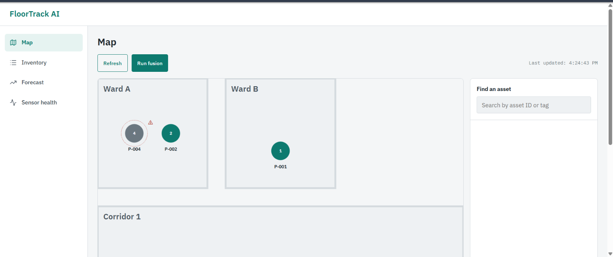
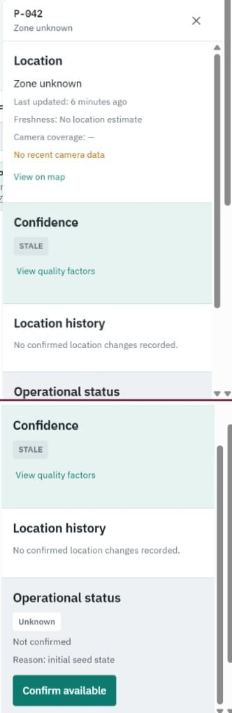
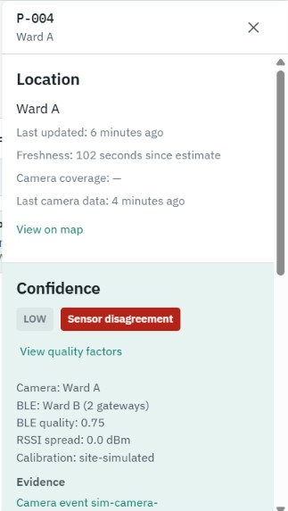
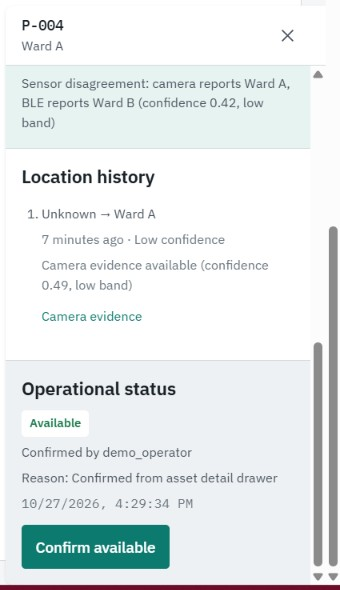
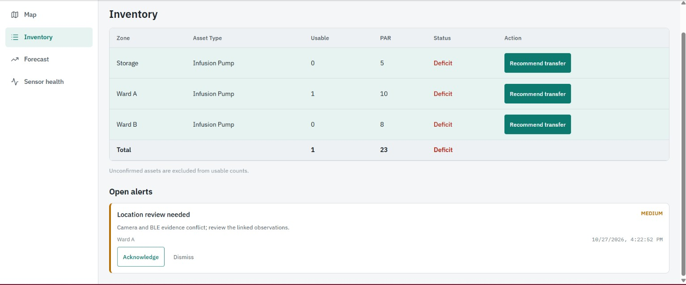
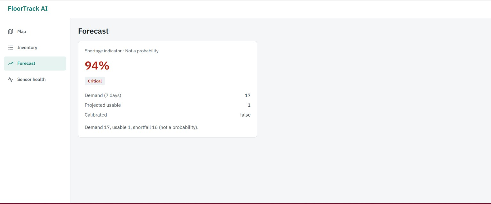
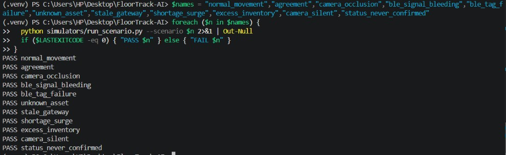
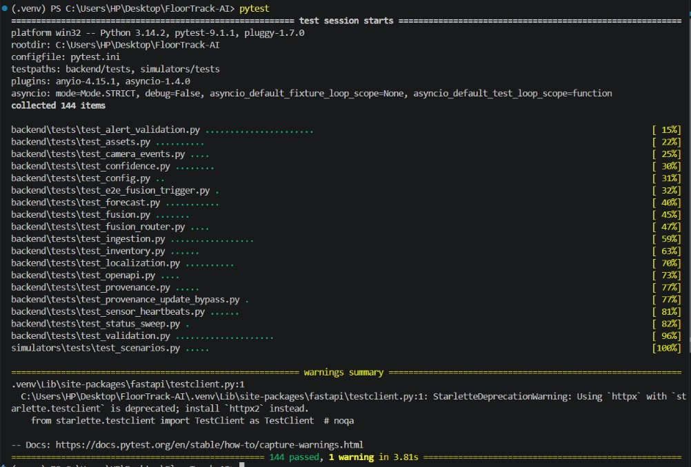

# FloorTrack AI — Hospital Asset Intelligence & Inventory Management

> **Category:** Software-only hospital asset intelligence prototype  
> **Domain:** Healthcare Technology · IoT · Asset Management  
> **Scope:** Software-only, local single-machine deployment, simulated sensor feeds  
> **Pilot Boundary:** Floor 1, Infusion Pumps (`P-001` through `P-012`, `P-042`)

---

## 1. Project Overview & Problem Statement

Movable medical equipment (infusion pumps, ventilators, wheelchairs) in clinical hospital wards is frequently unfindable when needed. Literature indicates unmonitored hospital fleets operate at roughly 30–42% utilization, clinical staff can lose 20–55 minutes per shift searching for devices, and hospital departments over-purchase or over-rent equipment by 20–30% to compensate.

FloorTrack AI solves this not through surveillance or theft attribution, but through an honest, uncertainty-aware tracking and inventory intelligence system. By fusing simulated optical detection at hallway chokepoints with Bluetooth Low Energy (BLE) RSSI telemetry from ceiling gateway nodes, FloorTrack AI delivers:
- **Zone-level location tracking** with an inspectable confidence score and confidence band.
- **Strict separation of location from availability**: sensors determine *where* an asset is; only named clinicians or workflow adapters can determine whether it is *usable*.
- **Neutral surplus/deficit inventory management** comparing usable counts against ward PAR levels.
- **Shortage forecasting** providing an uncalibrated shortfall ratio and demand/supply counts.
- **Draft-only integrations** with mock Slack/Teams webhooks and CMMS maintenance platforms.

---

## Screenshots

### Floor map with confidence and freshness


### Location and availability are separate facts


### Sensor disagreement creates a named review state


### Availability confirmed by a named user


### PAR inventory and neutral alerts


### Shortage forecast


### All scenarios and tests pass



## 2. Architecture & Design Principles

```
+-----------------------------------------------------------------------------------+
|                            SIMULATION & INGESTION LAYER                           |
|       BLE Gateway Batches (Multi-Gateway RSSI)       Hallway Camera Crossings     |
|              POST /api/v1/events/ble                 POST /api/v1/events/camera   |
+------------------------------------+-----------------------------+----------------+
                                     |                             |
                                     v                             v
+-----------------------------------------------------------------------------------+
|                              FLOORTRACK FUSION CORE                               |
|   1. Weighted Centroid Localization (WCL) using site-simulated log-distance constants|
|   2. Multi-gateway threshold: >= 2 gateways required; 1 gateway yields NO position |
|   3. 5-term confidence formula + conflict/stale penalties -> band (high/med/low/stale)|
|   4. Disagreement detection: camera doorway crossing vs BLE zone -> Review State   |
|   5. Sensor silence is inert: silence produces coverage figures, never an alert    |
+------------------------------------+----------------------------------------------+
                                     |
                                     v
+-----------------------------------------------------------------------------------+
|                        SQLITE PERSISTENCE & DATA MODEL                            |
|   - Location state written only by Fusion Core                                    |
|   - Operational status protected by SQLite triggers (requires named actor & reason) |
|   - Status expiry sweep decays stale confirmations to 'status_unknown'           |
+------------------------------------+----------------------------------------------+
                                     |
                                     v
+-----------------------------------------------------------------------------------+
|                            PRESENTATION & INTEGRATION                             |
|   Interactive React SVG Floor Map     PAR Imbalance & Neutral Surplus/Deficit     |
|   Asset Search & Provenance Drawer   Mock CMMS Drafts & Slack/Teams Webhook Logs  |
+-----------------------------------------------------------------------------------+
```

### Non-Negotiable Engineering Rules
1. **Sensor silence produces NO state**: A silent camera or quiet gateway produces a coverage figure and decaying confidence. It never marks an asset missing, moves an asset, or generates a status change.
2. **Location and availability are strictly separated**: Where an asset is located comes from sensor fusion. Whether it is usable comes exclusively from `POST /api/v1/assets/{asset_id}/operational-status` with provenance auditing. Sensors, simulators, and bulk imports are rejected by database triggers. Unconfirmed statuses decay to `status_unknown` and are excluded from usable inventory counts.
3. **Zone-level output only**: Centimetre-level or room-level accuracy is never claimed. A single-gateway BLE reading yields no position (`insufficient_gateways`). Calibration constants (`tx_power=-59.0`, `path_loss_exponent=2.0`) are labeled site-simulated.
4. **Inspectable confidence, not a black box**: Confidence is computed from five explicit evidence terms (camera confidence, BLE quality, zone agreement, freshness, coverage) and two penalties (conflict, staleness). Single-modality detections cannot receive the `high` band.
5. **Sensor conflict creates a named review state**: If camera crossing and BLE zone disagree, the engine logs `decision_status="sensor_disagreement"`, sets `review_state="needs_review"`, preserves the prior known zone, and files a review alert for a human. It never silently picks a winner.
6. **Neutral vocabulary**: Alert titles and messages are screened against prohibited terms (`hoarding`, `theft`, `stolen`, `neglect`) and individual staff names at write time.

---

## 3. Quick Start & One-Command Run

### Prerequisites
- Python 3.12+ (tested with Python 3.14.2)
- Node.js 18+ and npm

### Installation

#### Windows (PowerShell)
```powershell
# 1. Create and activate virtual environment
python -m venv .venv
.\.venv\Scripts\Activate.ps1

# 2. Install backend dependencies
pip install -r backend/requirements.txt

# 3. Install frontend dependencies
cd frontend
npm install
cd ..
```

#### Linux / macOS (Bash)
```bash
# 1. Create and activate virtual environment
python3 -m venv .venv
source .venv/bin/activate

# 2. Install backend dependencies
pip install -r backend/requirements.txt

# 3. Install frontend dependencies
cd frontend
npm install
cd ..
```

### Resetting the Demo Database
To restore the demo SQLite database to its pristine seeded state at any time, **stop the backend first** (press Ctrl+C in the terminal running `python run.py`), because the database file is locked while the server runs on Windows. Then run the reset and start the app again with `python run.py`:
```powershell
# Windows
.\.venv\Scripts\python backend/scripts/reset_demo.py

# Linux / macOS
python backend/scripts/reset_demo.py
```
This safely deletes `backend/data/floortrack.db` (and any WAL/SHM companion files), re-creates tables, triggers, and indices, and re-seeds all pilot zones, gateways, cameras, and assets.

### One-Command Run
Launch both backend and frontend servers with a single command from the project root:
```powershell
python run.py
```
This automatically:
1. Initializes and seeds the local SQLite database (`backend/data/floortrack.db`) with Floor 1, 6 zones, 4 BLE gateways, 3 hallway cameras, 3 PAR thresholds, and 13 infusion pumps in initial `status_unknown` state.
2. Starts the FastAPI backend at `http://127.0.0.1:8000`.
3. Starts the Vite frontend dev server at `http://localhost:5173`.

### Access Points
- **Web UI Dashboard:** [http://localhost:5173](http://localhost:5173)
- **Interactive Swagger Docs:** [http://127.0.0.1:8000/docs](http://127.0.0.1:8000/docs)
- **OpenAPI 3.1 Specification:** [http://127.0.0.1:8000/openapi.json](http://127.0.0.1:8000/openapi.json)

---

## 4. Running Tests

Run the complete pytest test suite (144 unit, integration, validation, and contract tests):
```powershell
.\.venv\Scripts\pytest
```

To run specific test modules:
```powershell
# Core validation suite (covers all non-negotiable rules)
.\.venv\Scripts\pytest backend/tests/test_validation.py

# OpenAPI 3.1 compliance and route matching
.\.venv\Scripts\pytest backend/tests/test_openapi.py

# Multi-modal fusion and review state tests
.\.venv\Scripts\pytest backend/tests/test_fusion.py

# Operational status provenance and SQLite trigger tests
.\.venv\Scripts\pytest backend/tests/test_provenance.py

# Simulator contract tests
.\.venv\Scripts\pytest simulators/tests/test_scenarios.py
```

---

## 5. Running Simulator Scenarios

The test scenarios simulate real-world sensor streams by POSTing valid payloads exclusively to public HTTP endpoints. They never access the database directly and never write operational status.

Run any scenario from the repository root:
```powershell
python simulators/run_scenario.py --scenario <scenario_name>
```

### Supported Scenarios

| Scenario | Command | Expected Output & Behavior |
|---|---|---|
| `normal_movement` | `python simulators/run_scenario.py --scenario normal_movement` | Asset `P-001` moves from Ward A to Ward B; agreeing camera and BLE readings place asset in Ward B with `confirmed` status. |
| `agreement` | `python simulators/run_scenario.py --scenario agreement` | Camera and multi-gateway BLE agree on Ward A for `P-002`; confidence rises to `high` band. |
| `camera_occlusion` | `python simulators/run_scenario.py --scenario camera_occlusion` | Hallway camera has no positive detection; multi-gateway BLE localizes `P-003` to Ward B as fallback (`low` band). |
| `ble_signal_bleeding` | `python simulators/run_scenario.py --scenario ble_signal_bleeding` | Camera detects `P-004` in Ward A while BLE wall-reflection estimates Ward B; engine triggers `sensor_disagreement` review alert and preserves prior zone. |
| `ble_tag_failure` | `python simulators/run_scenario.py --scenario ble_tag_failure` | BLE tag silent (0 gateways); camera-only detection places `P-005` in Ward A; operational availability remains completely untouched. |
| `unknown_asset` | `python simulators/run_scenario.py --scenario unknown_asset` | Camera sees unregistered asset tag; recorded as unverified detection with `unknown_asset=True` without creating an asset state. |
| `stale_gateway` | `python simulators/run_scenario.py --scenario stale_gateway` | BLE batch with timestamp older than 20 minutes; accepted as historical evidence and assigned `stale` confidence band. |
| `shortage_surge` | `python simulators/run_scenario.py --scenario shortage_surge` | Demand surge posted to `POST /api/v1/events/demand`; forecast reflects demand $\ge 100$, reports usable supply, and marks band `critical`. |
| `excess_inventory` | `python simulators/run_scenario.py --scenario excess_inventory` | Queries `GET /api/v1/inventory/recommendations`; verifies draft transfers require human confirmation and change no availability. |
| `camera_silent` | `python simulators/run_scenario.py --scenario camera_silent` | Healthy camera reports nothing; fusion updates zone coverage figure, asserts `state_changed=False`, and leaves location and availability untouched. |
| `status_never_confirmed` | `python simulators/run_scenario.py --scenario status_never_confirmed` | Camera places `P-009` in Ward A; because no clinician confirmed availability, status remains `status_unknown` and usable count in Ward A excludes `P-009`. |

---

## 6. Traceability Matrix: FR & AC to Code & Tests

| Requirement / Criterion | Description | Primary Code File | Primary Test / Scenario |
|---|---|---|---|
| **FR1** | Positive camera detection ingestion | [`events.py`](file:///backend/app/routers/events.py#L228-L341) | [`test_camera_events.py`](file:///backend/tests/test_camera_events.py) |
| **FR2** | Character-level ID resolution & unknown tags | [`identity.py`](file:///backend/app/services/identity.py#L1-L60) | [`test_validation.py`](file:///backend/tests/test_validation.py#L298-L315) |
| **FR3** | No display/screen error OCR pipeline | Architecture boundary | Architecture verification scan |
| **FR4** | Batched multi-gateway BLE ingestion | [`events.py`](file:///backend/app/routers/events.py#L142-L226) | [`test_ingestion.py`](file:///backend/tests/test_ingestion.py) |
| **FR5** | Gateway capabilities validation for phase/AoA | [`events.py`](file:///backend/app/routers/events.py#L172-L186) | [`test_ingestion.py`](file:///backend/tests/test_ingestion.py) |
| **FR6** | Multi-gateway WCL (2+ gateways required) | [`localization.py`](file:///backend/app/services/localization.py#L151-L232) | [`test_localization.py`](file:///backend/tests/test_localization.py) |
| **FR7** | Site-simulated calibration metadata returned | [`localization.py`](file:///backend/app/services/localization.py#L44-L60) | [`test_localization.py`](file:///backend/tests/test_localization.py) |
| **FR8** | Zone-level output only, no sub-metre claim | [`localization.py`](file:///backend/app/services/localization.py#L213-L232) | [`test_localization.py`](file:///backend/tests/test_localization.py) |
| **FR9** | Camera/BLE conflict produces review state | [`fusion.py`](file:///backend/app/services/fusion.py#L294-L386) | [`test_fusion.py`](file:///backend/tests/test_fusion.py) |
| **FR10** | Sensor silence produces no asset state | [`fusion.py`](file:///backend/app/services/fusion.py#L251-L290) | [`test_validation.py`](file:///backend/tests/test_validation.py#L409-L454) |
| **FR11** | Interactive digital map dashboard | [`FloorMap.tsx`](file:///frontend/src/components/FloorMap.tsx), [`MapPage.tsx`](file:///frontend/src/pages/MapPage.tsx) | Frontend browser verification |
| **FR12** | Search shows zone, band, freshness, status | [`AssetDetailDrawer.tsx`](file:///frontend/src/components/AssetDetailDrawer.tsx) | [`test_assets.py`](file:///backend/tests/test_assets.py) |
| **FR13** | Location history with evidence links | [`assets.py`](file:///backend/app/routers/assets.py#L91-L119) | [`test_assets.py`](file:///backend/tests/test_assets.py) |
| **FR14** | Inventory tracks availability; excludes unknown | [`inventory.py`](file:///backend/app/routers/inventory.py#L47-L95) | [`test_inventory.py`](file:///backend/tests/test_inventory.py) |
| **FR15** | PAR deficit alerts raised below minimum | [`inventory.py`](file:///backend/app/routers/inventory.py#L98-L155) | [`test_inventory.py`](file:///backend/tests/test_inventory.py) |
| **FR16** | Ranked surplus/deficit recommendations | [`inventory.py`](file:///backend/app/routers/inventory.py#L202-L265) | [`test_inventory.py`](file:///backend/tests/test_inventory.py) |
| **FR17** | Prohibited term & person name filter | [`inventory.py`](file:///backend/app/routers/inventory.py#L20-L46) | [`test_validation.py`](file:///backend/tests/test_validation.py#L623-L655) |
| **FR18** | Operational status route, triggers & expiry | [`assets.py`](file:///backend/app/routers/assets.py#L121-L182), [`database.py`](file:///backend/app/database.py#L49-L83) | [`test_provenance.py`](file:///backend/tests/test_provenance.py) |
| **FR19** | OpenAPI 3.1 REST compliance | [`main.py`](file:///backend/app/main.py#L31-L37), [`openapi.json`](file:///docs/openapi.json) | [`test_openapi.py`](file:///backend/tests/test_openapi.py) |
| **FR20** | Draft CMMS work orders require confirmation | [`integrations.py`](file:///backend/app/routers/integrations.py#L59-L113) | [`test_inventory.py`](file:///backend/tests/test_inventory.py) |
| **FR21** | HTTP-only sensor simulation runners | [`run_scenario.py`](file:///simulators/run_scenario.py) | [`test_scenarios.py`](file:///simulators/tests/test_scenarios.py) |
| **FR22** | Named failure scenarios with expected output | [`definitions.json`](file:///simulators/scenarios/definitions.json) | 11/11 CLI scenario passes |
| **AC1** | Zero hardware requirement (runs locally) | [`database.py`](file:///backend/app/database.py) | Full pytest run on local SQLite |
| **AC2** | Fusion inspectability & conflict review | [`fusion.py`](file:///backend/app/services/fusion.py), [`confidence.py`](file:///backend/app/services/confidence.py) | Scenario `ble_signal_bleeding` |
| **AC3** | Searchable map UI with separate availability | [`MapPage.tsx`](file:///frontend/src/pages/MapPage.tsx), [`AssetDetailDrawer.tsx`](file:///frontend/src/components/AssetDetailDrawer.tsx) | Interactive Map Walkthrough |
| **AC4** | Neutral PAR alerts sent to mock webhooks | [`alerts.py`](file:///backend/app/routers/alerts.py#L114-L163) | [`test_inventory.py`](file:///backend/tests/test_inventory.py) |
| **AC5** | OpenAPI spec matches registered routes | [`docs/openapi.json`](file:///docs/openapi.json) | [`test_openapi.py`](file:///backend/tests/test_openapi.py) |
| **AC6** | Sensor silence produces no asset change | [`fusion.py`](file:///backend/app/services/fusion.py#L251-L290) | Scenario `camera_silent` |
| **AC7** | Availability protected by trigger & decay | [`database.py`](file:///backend/app/database.py), [`status_sweep.py`](file:///backend/app/services/status_sweep.py) | [`test_provenance.py`](file:///backend/tests/test_provenance.py) |
| **AC8** | Forecast reproducible from demand inputs | [`forecast.py`](file:///backend/app/services/forecast.py) | [`test_forecast.py`](file:///backend/tests/test_forecast.py) |
| **AC9** | Scope strictly held to 1 floor & 1 asset type | [`seed.py`](file:///backend/scripts/seed.py), [`SCOPE.md`](file:///SCOPE.md) | Database seed verification |

---

## 7. Viva Defense & Technical Explanations

### How Confidence Is Calculated
FloorTrack AI avoids black-box machine learning for position confidence. Instead, `compute_confidence` in [`confidence.py`](file:///backend/app/services/confidence.py) uses a transparent 5-term evidence sum:
$$\text{Score} = 0.25 \cdot \text{Cam} + 0.25 \cdot \text{BLE} + 0.20 \cdot \text{Agree} + 0.15 \cdot \text{Fresh} + 0.15 \cdot \text{Cov} - \text{ConflictPen} - \text{StalePen}$$
- **Camera confidence** ($\le 1.0$): detector score of positive identification.
- **BLE quality** ($\le 1.0$): scaled by gateway count ($\ge 4$ yields 1.0), RSSI spread, freshness decay, and signal consistency.
- **Zone agreement**: $1.0$ if both modalities report the exact same zone; $0.5$ for adjacent zones; $0.0$ for non-adjacent zones.
- **Freshness**: decays linearly from 1.0 to 0.0 between 5 and 30 minutes of elapsed time.
- **Conflict penalty**: $-0.30$ deduction if modalities disagree on non-adjacent zones.
- **Stale penalty**: $-0.20$ deduction if readings exceed 15 minutes old.
- **Band assignment**: $\ge 0.80 \to \text{High}$, $\ge 0.55 \to \text{Medium}$, $\ge 0.30 \to \text{Low}$, $< 0.30 \to \text{Stale}$. A single modality is capped at Medium. Disagreement forces `decision_status="sensor_disagreement"`.

### How Availability Is Enforced
In clinical operations, knowing an IV pump is in Orthopaedics does NOT mean it is ready for patient use (it could be unsterilized or depleted).
FloorTrack AI enforces this separation at the database level:
- SQLite triggers abort any INSERT or UPDATE to operational status if `status_source` is not `user` or `workflow_adapter`.
- Ingestion events (`/events/camera`, `/events/ble`) update only location coordinates, fusion estimates, and last-seen timestamps.
- Available equipment has a confirmation window (default 24 hours). If not re-confirmed, `run_status_expiry_sweep` transitions the asset to `status_unknown`.
- Unconfirmed and maintenance devices are excluded from usable inventory counts in PAR calculations.

---

## 8. Acknowledgements & Open-Source References

FloorTrack AI gratefully credits and acknowledges the following open-source research repositories located in `reference/`:

1. **[MedTracker](https://github.com/)** (`reference/MedTracker-main`):
   - The replay runner pattern, event batching, and simulated sensor stream concepts were adapted from MedTracker's demonstration replay pipeline (`# adapted from reference/MedTracker/demo_replay.py`).
2. **[Indoor-Positioning-techniques](https://github.com/)** (`reference/Indoor-Positioning-techniques-master`):
   - Log-distance path-loss equations and Weighted Centroid Localization (WCL) formulations were adapted from this repository's geometric positioning algorithms (`# adapted from reference/Indoor-Positioning-techniques/positioning.py`).
3. **[Position-Annotated-BLE-RSSI-Dataset](https://github.com/)** (`reference/Position-Annotated-BLE-RSSI-Dataset-main`):
   - Provided reference signal propagation patterns and multi-gateway RSSI variation models for site-simulated RSSI generation.
